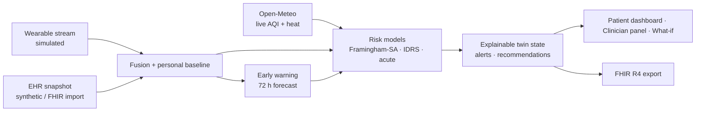

# VitaTwin — Your Living Digital Health Twin

Proof of concept for the **Digital Twin Challenge 2026** (Happiest Health · *Reimagining & Reforming Healthcare in India*).
Live demo: https://vita-twin-ten.vercel.app/ · Licence: MIT

> **Patients are synthetic.** No real personal health information is processed or stored. VitaTwin is decision support for clinician review, not a medical device and not a diagnosis.

## The brief, and how VitaTwin answers it

| Challenge asks for | VitaTwin |
|---|---|
| A dynamic virtual replica of a patient | A twin re-derived on every request from a live wearable stream + EHR snapshot; 5-second live panel; 10-day memory timeline |
| Wearable **and** EHR fusion | Hourly HR / HRV / SpO₂ / sleep / steps fused with labs, diagnoses, medications (`src/services/twin-engine.ts`) |
| Adverse-event prediction | **Early warning**: each person's own baseline, robust z-scores, 72-hour projection with lead time (`early-warning.ts`) |
| Explainability | Every score lists factor-by-factor contributions (counterfactual attribution), with literature notes |
| India relevance | South-Asian recalibration, Indian Diabetes Risk Score, Asian BMI cut-offs, FHIR R4 for ABDM, Indian cities |
| Real-world grounding | See below |
| What-if simulation | Server-side counterfactual sliders with physiological knock-on effects |
| Privacy | Synthetic patients, stateless FHIR import, server-side authz, security headers, rate limiting |

## What is real, what is simulated

| Layer | Status |
|---|---|
| Risk equations: Framingham 2008 general CVD, South-Asian hazard ×1.4 (ACC/AHA 2019), UKPDS-35 HbA1c adjustment, Indian Diabetes Risk Score (Mohan 2005) | **Real, published** |
| Air quality (PM2.5, AQI) and heat for the patient's city | **Real, live** (Open-Meteo, no key) |
| Model check on 303 real patients (UCI Cleveland) — AUC, ROC, risk quartiles | **Real dataset**, reproducible: `npm run validate` |
| FHIR R4 import of real hospital bundles (LOINC / SNOMED / ICD-10, unit conversion) | **Real interoperability** |
| Patients and wearable streams (6 personas across 6 cities) | Synthetic, labelled in the UI |

Validation (honest): AUC **0.71** (95% CI 0.65–0.76) vs age-only 0.64; disease prevalence rises 21% → 71% across risk quartiles. Small, non-Indian referral cohort — a discrimination sanity check, not a clinical validation. Limitations are shown on the `/validation` page.

## Run

```bash
npm ci
npm run dev          
npm test             
npm run validate     
npm run build
```

Optional: set `NEXT_PUBLIC_SUPABASE_URL` / `NEXT_PUBLIC_SUPABASE_ANON_KEY` for email sign-in (see `docs/DEPLOYMENT.md`).

## Architecture



All clinical computation runs on the server; the browser receives only the derived, explainable summary. See `docs/ARCHITECTURE.md`, `docs/MODEL_CARD.md`, `docs/SECURITY.md`.

## Demo path (3 minutes)

1. **Dashboard** → Rajesh (Hyderabad): early-warning card shows rising strain and an hours-to-urgent lead time; live stream updates every 5 s.
2. Switch to **Priya (Delhi)**: live smog changes her acute-risk drivers; alert cites real PM2.5.
3. **What-if**: quit smoking / lower HbA1c / lose weight → models re-run server-side.
4. **Clinician view**: six-patient panel sorted by urgency.
5. **FHIR**: load the sample ABDM-style bundle, then export the twin back as FHIR.
6. **Validation**: ROC and quartiles on 303 real patients, with limitations.

## Data sources and references

- D'Agostino et al., *Circulation* 2008;117:743 (Framingham) · Grundy et al., ACC/AHA 2019 · Stratton et al., *BMJ* 2000;321:405 (UKPDS-35) · Mohan et al., *JAPI* 2005;53:759 (IDRS)
- Brook et al., AHA statement, *Circulation* 2010;121:2331 (air pollution) · Cooney 2010, Cappuccio 2011, Fang 2020 (resting HR, sleep, HRV)
- Detrano et al., *Am J Cardiol* 1989;64:304 — UCI Heart Disease (CC BY 4.0) · Open-Meteo (CC BY 4.0) · ICMR-INDIAB 2023
