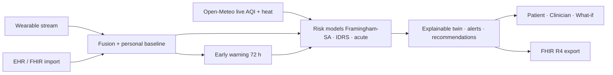

# VitaTwin — Your Living Digital Health Twin

Proof of concept for the **Digital Twin Challenge 2026** (Happiest Health · *Reimagining & Reforming Healthcare in India*).

**Live demo:** https://vita-twin-ten.vercel.app/  
**Repository:** https://github.com/Pavan3030-pr/VitaTwin  
**Licence:** MIT

> **Patients are synthetic.** No real personal health information is processed or stored. VitaTwin is decision support for clinician review, not a medical device and not a diagnosis.

---

## Team details

| Field | Details |
|---|---|
| **Team name** | TechGaint |
| **Member** | Chandra Pavansai |
| **College** | CMR Technical Campus |
| **Year** | 4th year |
| **Challenge** | Digital Twin Challenge 2026 — Happiest Health |

---

## Project title

**VitaTwin** — A living digital health twin for cardiometabolic risk prediction and personal-baseline early warning, designed for India’s clinical and ABDM context.

---

## Problem statement

Diabetes and hypertension are rising rapidly in India, while care remains largely **reactive** — adverse events are treated after they occur. Clinicians lack a continuous, explainable view that fuses:

- wearable physiology (heart rate, HRV, sleep, steps, SpO₂),
- EHR context (labs, diagnoses, medications), and
- local environment (air quality, heat).

Without that fusion, early deterioration that is still “within population normal” can be missed for a specific patient.

---

## Healthcare use case

**Clinician decision support** for cardiometabolic risk in primary and secondary care:

1. A **dynamic digital twin** re-derived from wearable stream + EHR snapshot  
2. **Personal-baseline early warning** with lead time (hours until projected urgent strain)  
3. **Explainable** 10-year CVD risk, diabetes progression risk, and acute stress risk  
4. **What-if** simulation (e.g. smoking cessation, HbA1c, weight)  
5. **ABDM-aligned FHIR R4** import/export and optional wearable CSV upload  

**Scope:** proof of concept / decision support only — **not** diagnosis, triage automation, or a regulated medical device.

---

## Technical stack

| Layer | Technology |
|---|---|
| Framework | Next.js 15 (App Router), React 19, TypeScript |
| UI | Tailwind CSS, Recharts |
| Compute | Server-side twin engine, risk models, early warning (Node) |
| Auth (optional) | Supabase Auth + row-level security |
| Interoperability | HL7 FHIR R4 (import/export), wearable CSV (Apple Health / Google Fit / generic) |
| Live data | Open-Meteo (PM2.5, AQI, heat) — no API key |
| Quality | Vitest unit tests, Playwright e2e, ESLint, GitHub Actions CI |
| Deploy | Vercel — https://vita-twin-ten.vercel.app/ |
| Licence | MIT |

---

## AI / ML model or framework details

VitaTwin uses **explainable, published risk equations and transparent baseline-drift rules** — not a black-box neural network.

| Model | Basis | Output |
|---|---|---|
| 10-year CVD risk | Framingham 2008 general CVD × South-Asian hazard **1.4** (ACC/AHA 2019) × UKPDS-35 HbA1c adjustment | % over 10 years |
| Diabetes risk / progression | Indian Diabetes Risk Score (Mohan 2005 / IDRS) + HbA1c, BMI (Asian cut-offs), eGFR | 0–100 score |
| Acute cardiac stress | Resting HR, HRV, sleep, stress + personal strain index + live PM2.5 / heat | 0–100 score |
| Early warning | Robust z-scores of nocturnal HR, HRV, sleep, steps vs **personal** baseline; damped 72-hour projection | Strain index, level, lead time |

**Validation (real data):** UCI Cleveland cohort (n = 303). VitaTwin CVD score AUC **≈ 0.71** (95% CI 0.65–0.76) vs age-only ≈ 0.64. Observed disease rises across risk quartiles (~21% → ~71%). See `/validation` and [`docs/MODEL_CARD.md`](./docs/MODEL_CARD.md).

**Limitations (published in-app):** referral US cohort (not South-Asian incident events); wearable/EHR demo patients are synthetic; early-warning weights are transparent design choices tuned on controlled backtests, not a prospective clinical trial.

Full model card: [`docs/MODEL_CARD.md`](./docs/MODEL_CARD.md)

---

## Demo video

**Unlisted YouTube demo (15–20 min):**  
*[Paste your unlisted YouTube link here after upload]*

Suggested walkthrough: Dashboard (Rajesh) → early warning → Priya + live AQI → what-if → clinician panel → wearable/FHIR import → validation page.

---

## Architecture diagram

- **PDF:** [`docs/Architecture.pdf`](./docs/Architecture.pdf)  
- **Narrative:** [`docs/ARCHITECTURE.md`](./docs/ARCHITECTURE.md)



All clinical computation runs **on the server**; the browser receives only the derived, explainable summary.

---

## Presentation

Project details and outcomes:

- **PowerPoint:** [`docs/VitaTwin_Presentation.pptx`](./docs/VitaTwin_Presentation.pptx)

---

## Open-source licence

**MIT Licence** — see [`LICENSE`](./LICENSE).  
Source code, documentation, and the live demo are **publicly accessible** without additional permissions or private access requests.

---

## What is real vs simulated

| Layer | Status |
|---|---|
| Risk equations (Framingham, IDRS, UKPDS-35, SA ×1.4) | **Real, published** |
| Air quality & heat for patient city | **Real, live** (Open-Meteo) |
| Model check on 303 real patients | **Real dataset** (`npm run validate`) |
| FHIR R4 import/export | **Real interoperability** |
| Demo patients & default wearable streams | **Synthetic** (labelled in UI) |
| Optional user wearable CSV | **User-supplied**; processed in memory, not stored |

---

## How VitaTwin answers the challenge brief

| Challenge asks for | VitaTwin |
|---|---|
| Dynamic virtual replica of a patient | Twin re-derived from wearable + EHR; live panel; 10-day timeline |
| Wearable **and** EHR fusion | HR / HRV / SpO₂ / sleep / steps + labs, diagnoses, meds |
| Adverse-event prediction | Personal-baseline early warning + lead time |
| Explainability | Factor-by-factor contributions with literature notes |
| India relevance | SA recalibration, IDRS, Asian BMI, FHIR for ABDM, Indian cities |
| What-if simulation | Server-side counterfactual sliders |
| Privacy | Synthetic cohort, stateless import, server-side authz |

---

## Run locally

```bash
npm ci
npm run dev          # http://localhost:3000
npm test
npm run validate     # regenerates validation.json from UCI Cleveland
npm run backtest-ew  # early-warning controlled backtest
npm run build
```

Optional: set `NEXT_PUBLIC_SUPABASE_URL` and `NEXT_PUBLIC_SUPABASE_ANON_KEY` for email sign-in (see [`docs/DEPLOYMENT.md`](./docs/DEPLOYMENT.md)).

---

## Demo path (product)

1. **Dashboard** → Rajesh (Hyderabad): early-warning lead time; live vitals  
2. **Priya (Delhi):** live smog drives acute-risk factors  
3. **What-if:** quit smoking / lower HbA1c / lose weight  
4. **Clinician view:** multi-patient urgency panel + lead time  
5. **Import:** wearable CSV and/or FHIR R4 sample bundle  
6. **Validation:** AUC, quartiles, calibration, early-warning backtest, limitations  

---

## Key documentation

| Doc | Path |
|---|---|
| Model card | [`docs/MODEL_CARD.md`](./docs/MODEL_CARD.md) |
| Architecture | [`docs/ARCHITECTURE.md`](./docs/ARCHITECTURE.md) · [`docs/Architecture.pdf`](./docs/Architecture.pdf) |
| Presentation | [`docs/VitaTwin_Presentation.pptx`](./docs/VitaTwin_Presentation.pptx) |
| Security | [`docs/SECURITY.md`](./docs/SECURITY.md) |
| PRD | [`docs/PRD.md`](./docs/PRD.md) |
| Demo script | [`docs/DEMO_SCRIPT.md`](./docs/DEMO_SCRIPT.md) |

---

## Data sources and references

- D’Agostino et al., *Circulation* 2008 — Framingham general CVD  
- Grundy et al., ACC/AHA 2019 — South-Asian risk discussion  
- Stratton et al., *BMJ* 2000 — UKPDS-35  
- Mohan et al., *JAPI* 2005 — Indian Diabetes Risk Score  
- Brook et al., AHA, *Circulation* 2010 — air pollution and CVD  
- Cooney 2010; Cappuccio 2011; Fang 2020 — resting HR, sleep, HRV  
- Detrano et al., *Am J Cardiol* 1989 — UCI Heart Disease (CC BY 4.0)  
- Open-Meteo (CC BY 4.0) · ICMR-INDIAB 2023  

---

## Public accessibility

- GitHub repository: **public**  
- Live demo: **public** (https://vita-twin-ten.vercel.app/)  
- Architecture PDF, presentation PPTX, model card, and licence: **in-repo, no extra permissions**  

*Built by Team TechGaint — Chandra Pavansai, CMR Technical Campus (4th year).*
